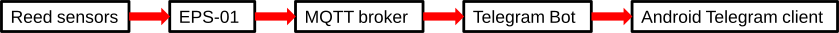
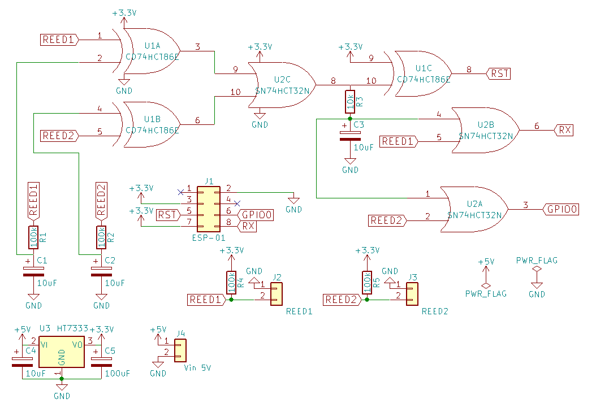
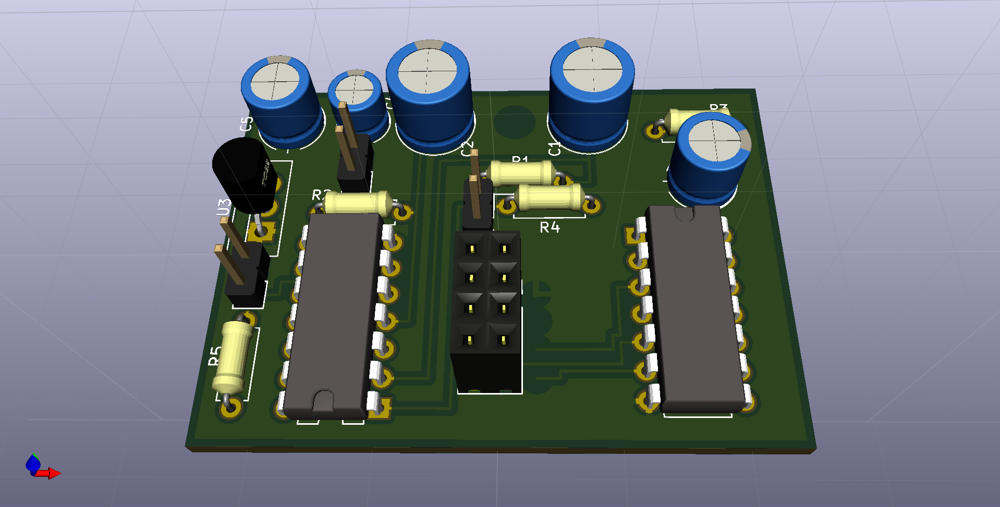
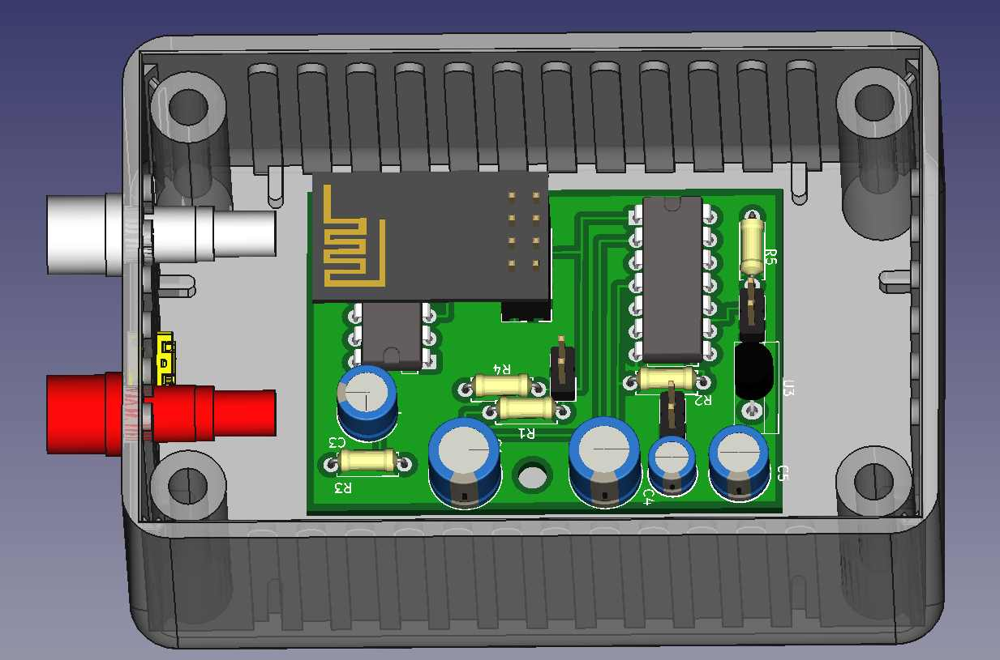
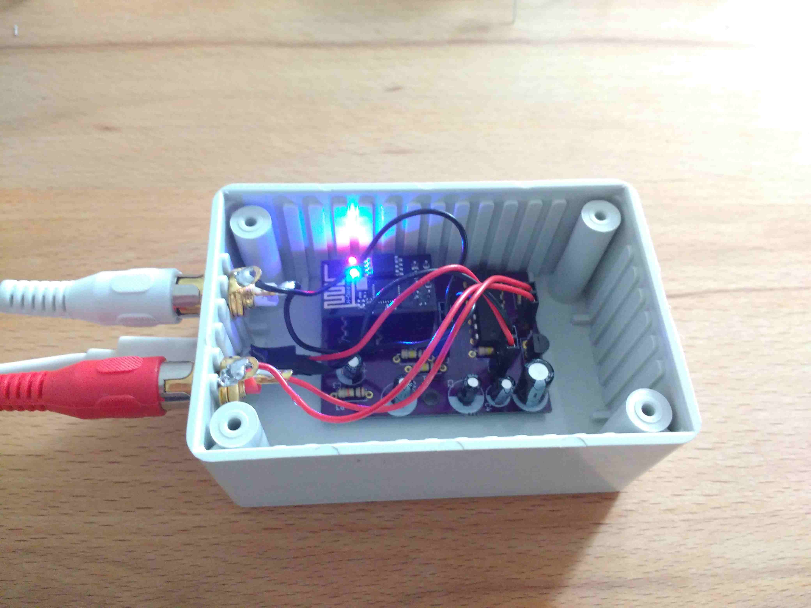
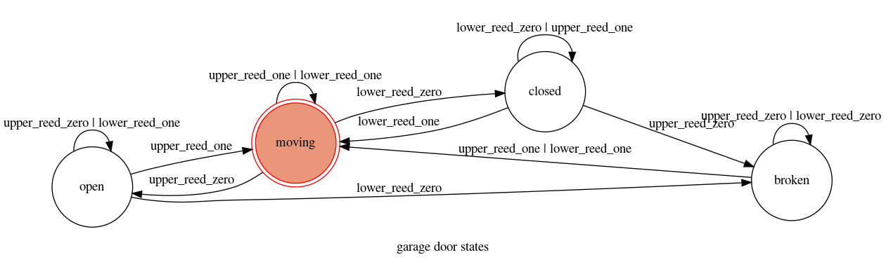

# yagds
This project is yet another garage door sensor.

Sensor data of changing door positions are captured by two reed sensors
connected to a ESP-01 module and
forwarded using the MQTT to a MQTT broker. A Python script subscribes to
these MQTT messages and implements a state machine representing the state of
the door (open, closed, moving). If the state of the door changes a Telegram
Bot notifies Telegram clients connected to it.



By using Telegram to distribute changes, the MQTT broker does not need to be
accessible from the internet. In addition, the script publishes the current
door state to a retained MQTT topic, so that Home Assistant can push it to
the phone and into Android Auto (see
[Android Auto via Home Assistant](#android-auto-via-home-assistant)).


## Hardware

### ESP-01 module

The hardware is based on the ESP-01 module using the microchip
[ESP8266](https://en.wikipedia.org/wiki/ESP8266) microcontroller. This
microchip includes a micro controller with WIFI and TCP/IP capabilities and
can be programmed with the Arduino tool chain. The ESP-01 provides easy
access to 8 of the pins of the microchip of which up to 4 can be used as
general purpose input/output (GPIO): GPIO0, GPIO2, TX(GPIO1), RX(GPIO3)

But the voltage level of some of the GPIO pins are used to select the
[boot mode](https://github.com/esp8266/esp8266-wiki/wiki/Boot-Process#esp-boot-modes)
during power-up/after a reset. The configuration which finally worked for me,
is using GPIO0 and GPIO3 and make sure, that they are at high voltage
level (3.3 V) during reset.

### Carrier Board

The micro controller should go to deep sleep mode after the door reached the
open or closed position. This saves energy if the hardware should be powered
by battery. To wake-up it up again, changes at the reed contacts should
trigger a pulse on the RST pin. Based on the idea described
[here (in German)](http://esp8266-server.de/Reedkontakt.html) for both, GPIO0
and RX, a XOR gate is used to compare the signal with a delayed one. The latter
is produced by RC-circuits. If the signal changes, the delayed signal keeps is
different from the un-delayed signal and the XOR gate outputs one (the two
gates in the top left part of the schematics below). If at least one of
the signals has changed its state, the output of the OR gate is one.
The output of the OR gate is inverted by another XOR gate (top right of the
schematics) and used as input for the RST (reset) pin.

To make sure, that the GPIO pins are at high voltage to boot correctly the
output of the OR gate is delayed by another RC circuit and ORed with the
signals of the GPIO pins. So these pins stay at high until the boot-up
has been completed.



The RC circuits and the OR/XOR gates together with a voltage regulator
for the 3.3 V power supply of the gates and ESP-01 are combined on
a PCB board which carry the ESP-01.



The cables of the reed contacts are connected with RCA (cinch) connectors
to the carrier board. A micro USB socket is used for power supply.

 

The schematics and PCB layout can be found in folder [layout_kicad](layout_kicad/).
They were created using [KiCad](http://kicad-pcb.org/)


## Software

### ESP-01 Firmware
The [firmware of the ESP-01](uploadSensorData/) is developed using
[PlatformIO](https://platformio.org/).

The communication with the MQTT
broker and the handling of configuration data (including updating them
over the air/the MQTT broker) is handled by the library
[Homie](https://github.com/marvinroger/homie-esp8266).

The library [simpleTimer](https://github.com/jfturcot/SimpleTimer) is
used to timeout connection setup and putting the micro  controller into
deep sleep state.

LED debug output flashing patterns are generated using the library
[jled](https://github.com/jandelgado/jled).

To set the configuration, add the file `data/homie/config.json` and
upload it the ESP-01 using Upload SPIFFS image.
```
{
  "name": "YAGDS",
  "device_id": "door_sensor",
  "device_stats_interval": 60,
  "wifi": {
    "ssid": "xxx",
    "password": "yyy"
  },
  "mqtt": {
    "host": "alpha",
    "port": 8883,
    "base_topic": "homie/",
    "auth": true,
    "username": "aaa",
    "password": "bbb",
    "ssl": true,
    "ssl_fingerprint": "123456789abcedf"
  },
  "ota": {
    "enabled": false
  },
  "settings": {
    "sensor_update_interval": 2,
    "max_resend": 5,
    "connection_timeout": 30,
    "sleep_timeout": 10
  }
}
```

Known issues: 
* My board is affected by this 
[bug](https://github.com/marvinroger/homie-esp8266/issues/522), 
which requires 
[patching](https://github.com/esp8266/Arduino/issues/4061#issuecomment-368273656) 
the ESP8266 core for Arduino.
* To use SSL fingerprints for the connection between the ESP-01
and a MQTT broker, a special build flag has to set: 
`build_flags = -DASYNC_TCP_SSL_ENABLED=1`. Also consider this
[issue](https://github.com/marvinroger/async-mqtt-client/issues/53).

### Telegram Bot with state machine
A [Python script](mqtt_telegram_bot/) determines the state of
the door and sends out messages if the state changes.
[paho-mqtt](https://pypi.org/project/paho-mqtt/) is used
to subscribe to the MQTT broker to receive the message from the ESP-01.
The transitions between different states of the door are followed
using the library
[transitions](https://pypi.org/project/transitions/). Message
of the current signal of the reed contacts can trigger changes between
the different door states as shown in the picture below.


If a transition causes a state change, also message is sent using the
[Python Telegram Bot](https://pypi.org/project/python-telegram-bot/)
library.

The `bot.py` scripts looks for the configuration file 
`.mqtt_telegram_bot.ini` in the $HOME directory of the user, or
for the file specified with the option `-c` at startup. It 
contains information about the connection to the MQTT broker and the
Telegram Bot.
```
[MQTT]
broker = broker.address
ca = ~/mqtt_ca.crt
username = username
password = password
topics_path = homie/door_sensor/reeds/#
remind_interval = 300
state_topic = yagds/door/state

[Telegram]
token = TOKEN
chat_id = 12345
```

`state_topic` is optional (default `yagds/door/state`). Every time the door
state actually changes, the new state (`open`, `closed`, `moving` or
`broken`) is published to this topic with QoS 1 and the retain flag set.
Manual corrections via the Telegram command `/state open|closed` are
published as well.

### Android Auto via Home Assistant
Since about May 2026 the official Telegram Android app no longer shows
messages in Android Auto
([Telegram bug 62558](https://bugs.telegram.org/c/62558)). To get the door
state into the car again, Home Assistant is used as the delivery channel:

```
ESP-01 ──MQTT──► Mosquitto ◄──► bot.py (state machine)
                     │             publishes yagds/door/state (retained)
                     ▼
              Home Assistant ──Firebase push──► HA Companion app ──► Android Auto
```

Home Assistant subscribes to the state topic and sends push notifications
with `car_ui: true`, which makes them appear in Android Auto. The push goes
out via Firebase Cloud Messaging, so the server only needs outbound internet
access. The MQTT broker stays internal, and no VPN or open port is needed.
The Telegram bot keeps running in parallel.

#### Broker
* The bot's Mosquitto user needs write access to `yagds/#`.
* Create a separate Mosquitto user for Home Assistant with read access to
  `yagds/#` (and `homie/door_sensor/#` if the raw values are wanted).

#### Home Assistant
Run Home Assistant as a container on the broker host, for example:
```
docker run -d --name homeassistant --restart=unless-stopped \
  -e TZ=Europe/Berlin -v /opt/homeassistant:/config \
  --network=host ghcr.io/home-assistant/home-assistant:stable
```
Add the MQTT integration (port 8883, Home Assistant's broker user). Under the
advanced settings, set broker certificate validation to *Custom* and upload
the broker's CA certificate.

The sensor and automations are kept in a
[package](https://www.home-assistant.io/docs/configuration/packages/), so
they do not clash with an existing `mqtt:` section or with
`automation: !include automations.yaml` in `configuration.yaml`. Enable
packages in `configuration.yaml` (add the `packages` line to the
`homeassistant:` block, or add the block if there is none):
```yaml
homeassistant:
  packages: !include_dir_named packages
```
Then create `packages/garage_door.yaml` next to `configuration.yaml`:
```yaml
mqtt:
  sensor:
    - name: "Garage door"
      unique_id: yagds_garage_door
      state_topic: "yagds/door/state"
      icon: mdi:garage
  binary_sensor:
    - name: "Garage door open"
      unique_id: yagds_garage_door_open
      state_topic: "yagds/door/state"
      device_class: garage_door
      value_template: "{{ 'OFF' if value == 'closed' else 'ON' }}"

automation:
  - alias: "Garage door changed"
    mode: queued
    triggers:
      - trigger: state
        entity_id: sensor.garage_door
        not_from: ["unknown", "unavailable"]
        not_to: ["unknown", "unavailable"]
    actions:
      - action: notify.mobile_app_<your_phone>
        data:
          title: "Garage"
          message: "Door is {{ trigger.to_state.state }}"
          data:
            car_ui: true
            channel: "Garage"
            importance: high
            notification_icon: mdi:garage

  - alias: "Garage door still open"
    triggers:
      - trigger: state
        entity_id: sensor.garage_door
        to: "open"
        for: "00:10:00"
    actions:
      - action: notify.mobile_app_<your_phone>
        data:
          message: "Garage door open for 10 minutes"
          data: { car_ui: true, channel: "Garage", importance: high }
```
The second automation does the same job as the bot's `remind_interval`
reminder. Home Assistant merges the package's `mqtt:` and `automation:`
entries with those in `configuration.yaml`. Check the configuration
(Developer tools > YAML) and restart Home Assistant to load the new package.
Automations defined in a package are read-only in the UI editor.
`mode: queued` makes sure that quick successive changes (e.g. `moving`
followed by `closed` a moment later) each send a notification; with the
default mode `single` the second one would be dropped while the first is
still being sent. `not_from`/`not_to` suppress notifications when the
sensor becomes `unavailable` or `unknown` (e.g. while Home Assistant
restarts or the connection to the broker is lost) and when it recovers.

`sensor.garage_door` holds the exact state (`open`, `closed`, `moving`,
`broken`). `binary_sensor.garage_door_open` is for display: with
`device_class: garage_door`, Home Assistant shows open/closed garage icons
and colors on its own. Everything except `closed` counts as open, so `moving`
and `broken` show as open as well.

Both entities can be found under Settings > Devices & services > Entities.
To show them on a dashboard:
1. Settings > Dashboards > Add dashboard > "New dashboard from scratch",
   e.g. named "Garage" with icon `mdi:garage`.
2. Open it from the sidebar, click the pencil icon to edit, then
   "+ Add card" in a section.
3. Pick "Manual" at the bottom of the card list and paste:
```yaml
type: vertical-stack
cards:
  - type: tile
    entity: binary_sensor.garage_door_open
    name: Garage
  - type: entities
    entities:
      - entity: sensor.garage_door
        name: Exact state
  - type: history-graph
    hours_to_show: 24
    entities:
      - entity: binary_sensor.garage_door_open
        name: Garage door
```
The dashboard is also shown in the Companion app.

#### Phone
1. Install the **Home Assistant** app from the Play Store. The F-Droid
   "minimal" build lacks Google Play services and does not work with
   `car_ui` notifications.
2. Connect it to Home Assistant while on the home Wi-Fi. This creates
   `notify.mobile_app_<your_phone>`; use that name in the automations.
3. After the first notification, enable pop-ups for the "Garage"
   notification channel in Android's app settings for Home Assistant.
4. Keep Home Assistant visible in the Android Auto launcher.
5. Optional: add `sensor.garage_door` to the Android Auto favorites in the
   Companion app settings. Note that this live view needs the phone to reach
   Home Assistant (e.g. via Nabu Casa or a Cloudflare Tunnel); the
   notifications do not.

Firebase limits pushes to 500 per day per device, and notification content
is not end-to-end encrypted. If notifications appear on the phone but not in
the car, check the channel's pop-up setting, that Home Assistant is visible
in the Android Auto launcher, and Android Auto's "show message
notifications" setting.

See the [Android Auto](https://companion.home-assistant.io/docs/android-auto/)
and [notification](https://companion.home-assistant.io/docs/notifications/notifications-basic/)
documentation of the Companion app for details.

## Authors

* **Joachim Herb** - [jmozmoz](https://github.com/jmozmoz)

## License

This project is licensed under [GPL v3](LICENSE)
